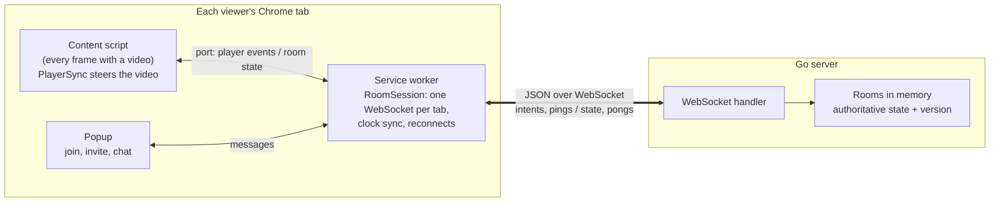

# insync

Keep everyone's video playback in sync, on YouTube and on any site that plays
video through an HTML5 `<video>` element. A Go server owns each room's playback
state; a Chrome extension steers the local player toward it. The goal is
measured sync quality: drift numbers under simulated bad networks, not just
"it works."

> Status: the core is done. Rooms sync play, pause, seek, speed and choice of
> video on YouTube and other HTML5 video sites, with scheduled starts, drift
> correction, buffering pauses, reconnects, chat and invite links, plus
> host-only rooms and notices over the video saying who did what. Measured
> drift is 17–46 ms at p95 once settled, under simulated bad networks (see
> [results](#results)). The server is ready to deploy.

## Architecture



Browsers never talk to each other. Every action goes to the server as an
intent, the server applies it to the room and broadcasts the new state, and
every player steers itself toward that state. The content script runs in
every frame, so a player inside a cross-origin iframe opens its own port to
the service worker like any other.

## Layout

```
server/                 Go sync server (rooms, WebSocket, clock-sync pings)
  cmd/server/           entry point
  internal/room/        authoritative room state and expected position
  internal/protocol/    JSON message types and validation (mirrors packages/protocol)
  internal/server/      HTTP + WebSocket handlers
packages/
  protocol/             wire message types and validators; PROTOCOL.md is the spec
  sync-core/            pure TypeScript sync logic (clock offset, drift control), no DOM
  extension/            Chrome Manifest V3 extension (content script, service worker, popup)
  harness/              simulated clients that measure drift
testpage/               plain page with a <video> for local testing (milestone 1)
```

The sync logic lives in `sync-core` with no DOM access, so the extension and
the harness run exactly the same code.

## Prerequisites

- Go 1.24+
- Node 22+
- [golangci-lint](https://golangci-lint.run/) v2 (for `server` linting)

## Run it

```sh
# Server, also serving the test page at http://localhost:8080
cd server && go run ./cmd/server -static ../testpage

# TypeScript
npm install
npm run build      # builds the extension into packages/extension/dist
npm run harness    # simulated drift report (see packages/harness/RESULTS.md)
```

### Two-tab demo

1. Put a video named `sample.mp4` in `testpage/` (video files are gitignored).
2. Start the server as above and build the extension.
3. Open `chrome://extensions`, enable Developer mode, and "Load unpacked" from
   `packages/extension/dist`.
4. Open http://localhost:8080 in two tabs. In each one, click the extension's
   icon and join the same room code (the server field defaults to
   `ws://localhost:8080/ws`).
5. Play, pause, seek or change the speed in either tab; the other follows.

If a tab says Chrome blocked playback, click play once in that tab: Chrome only
lets a page start sound after you've interacted with it.

### YouTube and other sites

The same steps work on YouTube or any site that plays video in a `<video>`
element. Keep the server running, reload the extension on `chrome://extensions`
after rebuilding, then open the same video in two tabs and join the same room
in each. Reload any tab that was already open before the extension loaded.

- **Ads.** While an ad plays in one tab, that tab sits out (the popup says so)
  and the others keep going. When the ad ends, it jumps to where the room is.
- **Which video.** On YouTube only the main player is synced, never the hover
  previews. Elsewhere the extension picks the visible, playing, largest video.
- **Switching video.** The room remembers which video it's on. Open another
  video in any tab and every other tab in the room goes there too, starting
  from the beginning and keeping play or pause as it was. Joining a room from
  another page takes you to the room's video. On YouTube only watch and Shorts
  pages count, so browsing the home page or search doesn't move anyone.
- **Joining mid-video.** The first person in a new room keeps their place:
  the room starts from wherever their video already is. Anyone who joins after
  that jumps to where the room is now.
- **Not supported yet:** Netflix, Disney+ and other DRM sites, which use custom
  players that fight outside control and would need a per-site adapter.

### Watching the same thing

Every tab tells the room how long its video is. If two people's videos differ
by more than 2 seconds (another episode, a version with a different intro, a
trailer), the popup warns and lists everyone's length, so you can check you're
on the same thing before pressing play.

### Host-only rooms

Whoever joins a room first is its host, marked "(host)" in the popup's member
list. The host can tick **Only the host controls playback** in the popup: from
then on, anyone else's play, pause, seek, speed change or switch of video is
undone in their tab instead of reaching the room, and their popup says who is
in control. If the host leaves, the person who has been in the room longest
takes over.

### Seeing who did what

When someone else plays, pauses, seeks, changes the speed, switches video or
turns host-only on or off, a short notice shows in the top right corner of the
video for a few seconds, for example "Sam paused at 12:34". Notices also say
who joined or left, show chat messages, and say who the room is waiting for
while it pauses for buffering. They show in fullscreen too, unless the site
puts the bare `<video>` element in fullscreen, which leaves no room for
anything else. Untick **Show what others do on the video** in the popup to
turn them off.

### Inviting someone

Once you're in a room, click **Copy invite link** in the popup and send the
link. It's the room's video page with the room code added after a `#` (and
the server, if you aren't using the default one), for example
`https://www.youtube.com/watch?v=abc123#insync=7f3a9c21`. Opening it with the
extension installed joins that tab to the room straight away, using the name
saved in the popup (or "Guest"). The part after `#` never reaches the site.

### Dropped connections

If the connection to the server drops (Wi-Fi blip, laptop sleep, server
restart), the popup says it's reconnecting and the tab keeps playing along with
the last state it had. It retries after 1 s, then 2, 4, 8 and 10 s, and rejoins
as the same person; anything you play, pause or seek meanwhile is sent once
it's back. The server drops connections that have been silent for a minute, so
someone whose laptop went to sleep leaves the member list.

Chrome also stops the extension's background worker now and then (after an
update, or to save memory), which closes every tab's connection. Each tab
remembers its room for as long as the browser is open, so a tab in a room
starts the worker again within a second and rejoins as the same person.

## Deploying the server

The server is one small Go binary with no database, so any host that runs a
Docker image works. Rooms live in memory: run a single instance, and expect
rooms (and chat) to reset when it restarts. A room nobody has been in for 10
minutes is forgotten too, so the server's memory doesn't grow with every
room ever used.

- `server/Dockerfile` builds a ~15 MB image. It listens on `$PORT` (8080 by
  default), answers health checks at `/healthz`, and shuts down cleanly on
  `SIGTERM`.
- **Fly.io:** `server/fly.toml` is ready. From `server/`, run
  `fly launch --copy-config --no-deploy` once (pick a unique app name), then
  `fly deploy`. The server is then at `wss://<app>.fly.dev/ws`.
- **Render:** `render.yaml` is a blueprint for the same image. Create a
  Blueprint from the repo; the server is then at
  `wss://<service>.onrender.com/ws`. Render's free plan sleeps after 15 idle
  minutes, which drops everyone's connection, so the blueprint uses a paid plan.

The host terminates TLS, so the extension connects with `wss://`. Build the
extension for the deployed server so nobody has to type its address:

```sh
INSYNC_SERVER=wss://<app>.fly.dev/ws npm run build
```

Invite links then leave the server out, since everyone's extension already
points at it.

## Lint and test

```sh
# Go
cd server && go vet ./... && go test -race ./... && golangci-lint run

# TypeScript
npm run typecheck && npm run lint && npm test
npm run format     # apply Prettier
```

### End-to-end smoke test

`npm run e2e` builds the extension and the Go server, starts the server on a
page with a `<video>`, and opens two tabs of a real Chromium with the
extension loaded. Both join one room through an invite link, and the test
checks that play, pause, seek and speed changes in one tab show up in the
other, that in a host-only room only the host's changes do, that each
tab's video length reaches the room, and that both tabs rejoin as themselves
after the extension's service worker is stopped. It needs Go and a Playwright Chromium: run
`npx playwright install chromium` once, or point `CHROMIUM_PATH` at a
Chromium you already have.

## How sync works

- **Room state.** The server stores playing/paused, position `P` at server time
  `T0`, rate and a version. Expected position at time `t` is
  `P + (t − T0) × rate` while playing.
- **Clock sync.** Clients ping the server, keep the lowest-RTT samples and
  estimate their offset NTP-style (`sync-core/src/clock.ts`).
- **Scheduled starts.** A play, or a seek while playing, starts at server
  time `T + lead`, a little more than the slowest member's round trip ahead,
  so every video starts at the same moment instead of whenever the message
  arrives. Whoever pressed play waits for the room to reach their video
  rather than jumping back (`server/internal/room`, `extension/src/player.ts`).
- **Drift correction.** While a video plays, the extension compares it with the
  room's expected position twice a second. Under ~50 ms off it does nothing, up
  to ~1 s it nudges `playbackRate` by 3% until it's back in line, beyond that it
  seeks, at most once every 3 s so a slow-buffering video isn't stuck seeking
  (`sync-core/src/drift.ts`, applied in `extension/src/player.ts`).

## Design decisions

- **Nudge the speed, don't seek.** A seek stalls the video while it loads and
  is visible; playing 3% faster or slower isn't. So drift under ~1 s is fixed
  with `playbackRate` and only bigger drift seeks. Under 50 ms nothing
  happens, so videos aren't nudged back and forth over noise. The thresholds
  are the plan's starting guesses; the harness shows they keep settled drift
  under 50 ms at p95.
- **Echo suppression.** Applying the room's state fires the same `play`,
  `pause` and `seeked` events a user's click does, and sending those back
  makes two tabs bounce commands forever. Instead of guessing which events
  the extension caused, a local event only counts as the user's when it
  disagrees with the room (playing while the room is paused, or far from
  where the room should be). The extension's own changes always agree, so
  they are never sent back, however late their events arrive
  (`extension/src/player.ts`).
- **Conflicts: the later arrival wins.** Anyone can control playback
  (unless the host makes the room host-only). The
  server applies intents in the order they arrive, bumps the room's version
  and broadcasts; players ignore states older than the one they have. Two
  people pressing at once both converge on whichever reached the server last.
- **Buffering pauses the room.** When someone's video stalls for data, the
  room pauses where it is and resumes, on a scheduled start, once nobody is
  still loading. Anyone pressing play or pause overrides the wait, which is
  the way out when one video is stuck. A YouTube ad in one tab doesn't pause
  anyone: that tab sits out and jumps to the room when the ad ends.
- **Joins and reconnects get a snapshot.** A joining or reconnecting tab gets
  the room's full state and seeks to where the room is now. A dropped
  connection retries with backoff and rejoins as the same member. Everyone's
  member ID is visible to the room, so rejoining also takes a private resume
  token the server gave only that member; without it, an ID someone else is
  using joins as a new member instead of taking over theirs (or the host's).
- **Sync logic has no DOM.** Clock sync and drift control live in
  `sync-core`, so the harness runs the exact code the extension runs, on a
  simulated clock.

## Results

Drift from where the server says the room should be, measured by running the
extension's real sync code over simulated bad networks, five ten-minute runs
per scenario. The scenarios, how it's measured and why the numbers look like
this are in [sync drift results](packages/harness/RESULTS.md). Regenerate both
tables with `npm run results -w @wps/harness`.

<!-- results:start -->

| Scenario      | Drift p50 | Drift p95 | Drift max | p95 incl. catch-up | Time within 100 ms | Converge after seek (median / max)     |
| ------------- | --------- | --------- | --------- | ------------------ | ------------------ | -------------------------------------- |
| Baseline      | 15 ms     | 46 ms     | 71 ms     | 47 ms              | 99.9%              | 0.2 s / 0.2 s                          |
| Cross-country | 9 ms      | 35 ms     | 98 ms     | 36 ms              | 99.7%              | 0.6 s / 0.6 s                          |
| Bad Wi-Fi     | 14 ms     | 44 ms     | 100 ms    | 45 ms              | 99.2%              | 1.3 s / 2.6 s                          |
| Lag spike     | 12 ms     | 45 ms     | 100 ms    | 46 ms              | 99.7%              | 0.3 s / 0.4 s                          |
| Mixed room    | 6 ms      | 17 ms     | 100 ms    | 289 ms             | 93.6%              | 1.1 s / 3.9 s (6 of 595 never settled) |

Lag spike, back in sync after the stall ended: 1.2 s, 0.3 s, 0.3 s, 1.7 s, 0.3 s.

<!-- results:end -->

## Roadmap

1. ~~Rooms and naive sync across two tabs of the test page~~
2. ~~Real sync: clock offset, scheduled starts, drift correction, debug overlay~~
3. ~~Browser extension working end to end on YouTube~~
4. ~~Robustness: buffering, reconnects, late joiners, conflicts, chat~~
5. Measure and ship: ~~network-impairment harness~~, ~~results table~~,
   deploy (configs ready, not live yet)

Since then:

- Host-only rooms.
- A warning when people's videos differ in length.
- Notices over the video saying who played, paused, seeked, joined or left.
- Resume tokens, so nobody can take over someone else's place in a room.
- Tabs rejoin their room after Chrome restarts the extension's service worker.
- Rooms that have been empty for 10 minutes are forgotten.
